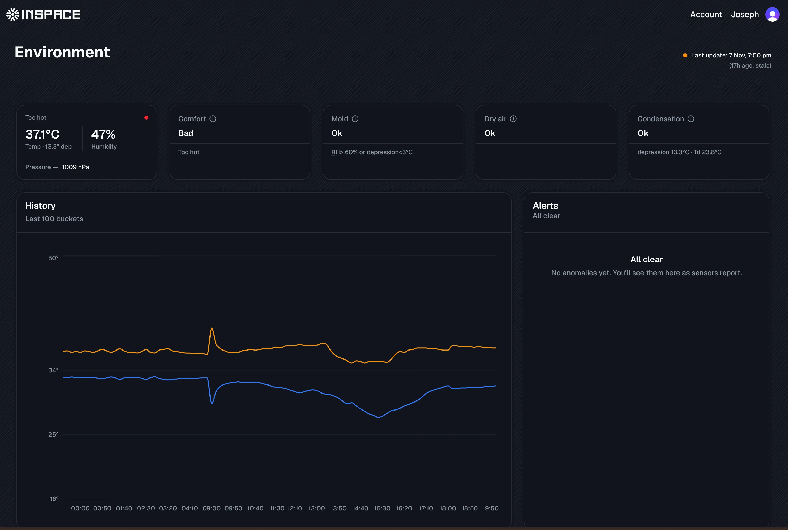

> From our [last article](/blog/our-first-hack), where we did a deep‑dive into the hardware and build process, we spoke about our first hack: an air quality tracking device we designed, programmed, and built from scratch.

We’ve given that device a name: **SpaceO** 

Spaceo helps us keep track of the temperature and humidity readings at InSpace. It was commissioned on the 23rd of September, 2026. InSpace’s founder wanted to measure environmental comfort and better understand and monitor customer comfort virtually. The goal was to simply improve the quality of service we provide to our customers.

[Whispers] Sustained productivity requires a comfortable temperature.

Collecting readings is only half the story. We also needed a way to make sense of the data. Here’s a look at what we’ve built so far and some of the insights we are beginning to uncover.

So we built a dashboard for visualizing the readings. That’s what this article is all about.

Spaceo comes equipped with a Wi-Fi module that allows it to connect to a network and transmit data. To make this work reliably, we created a dedicated Wi-Fi network for our IoT experiments, which Spaceo stays connected to during operational hours in our co-working space.

At the moment, Spaceo is powered by a 30,000mAh power bank. On a full charge, it takes about a week to deplete. This is the 3rd week of continuous data collection, and we’ve made some interesting discoveries.

By the third day we had gathered enough data to start visualizing the readings over time on our dashboard. This also got us thinking about the insights we could generate from data collected by all three sensors: temperature, humidity, and pressure.

## Breaking down the dashboard  

Let’s take a closer look at the different sections of the dashboard and what each one tells us. 
 
### Quick Insights:  

After reviewing our findings, we agreed to focus on these first:  
1. **Comfort**: How comfortable the co-working space is for customers.
1. **Mold Risk**: Whether humidity levels are high enough to encourage mold growth.
1. **Dry Air**: Whether the air is too dry or has enough moisture for easy breathing.

### History Graph:

The history graph lets us track how the readings change over time, making it easier to spot anomalies, and improve data collection and our algorithm.

### Temperature Calendar:

This temperature calendar gives us a visual overview of temperature changes from day to day. Each day has a score based on the average temperature readings recorded that day. 

Looking at the heatmap, we noticed that the co-working space was relatively hot. To be sure our readings were accurate and our sensors were well calibrated, we compared the readings with the readings from a thermometer placed in the same place.

### What we’ve found so far

To test how responsive the space was, we turned on the A/C cooling between 2pm and 6pm every day. Both units were set to 16°C, but the average room temperature only dropped by about 2–3°C. We kept our two industrial fans running to help circulate the air.

The interesting part is how different the numbers felt from reality. The room felt comfortably cool (not freezing), but the readings still hovered above 30°C. That gap between “how it feels” and “what the sensor says” has pushed us to think more carefully about placement, calibration, and which comfort ranges actually matter for people using the space.

On the human side, comfort complaints dropped after we made these changes. Two customers in particular mentioned they loved the cooler space and the idea behind the project. Before this, most complaints were about heat and the noise from our industrial fan. Now, we have fewer complaints and a clearer way to see whether the changes we make are working.

### What’s next?

Spaceo today is a passive observer: it helps us see what the room feels like and how that changes over time. Our next step is to give it a bit more agency. We’re exploring ways to automatically adjust the space temperature using dedicated devices, ideally small magnetic modules we can attach where they’re needed. **The goal is to move from “check the dashboard and tweak things” to a smarter system that quietly tunes the environment for comfort on its own.**

### Conclusion
We now have a dedicated dashboard for tracking InSpace room temperature with the goal of maintaining customer comfort. We'll improve on the algorithm and add more metrics to this dashboard as needs arise.

## Join the community
Join hundreds of creators building African's future from the heart of Rivers.

- Join the [Whatsapp Community](https://chat.whatsapp.com/KDQZCN58c92Fi1AGRXMrOu?mode=gi_t "Join InSpace Whatsapp Community") to stay up to date with the latest news and announcements.
- Follow [InSpace](https://instagram.com/inspaceHQ) on Instagram

As always, we’d love to hear your thoughts. If you have ideas about the tools, infrastructure or resources that could help make our community even stronger, join the group or Send us an [E-mail](https://inspace.ng/shortlinks/email). Some of our best ideas begin exactly that way.
